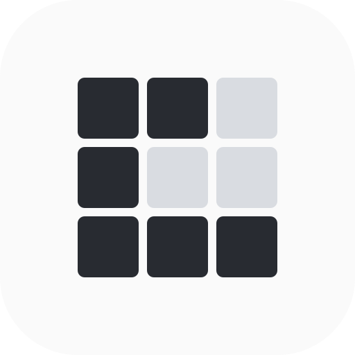
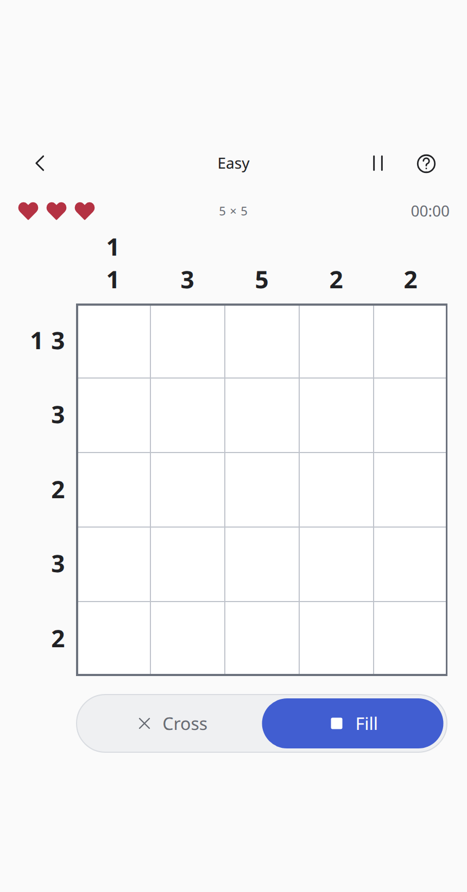

<p align="center">
  
</p>

# Nonogram

**Find the picture, one square at a time.**

A logic puzzle where row and column clues tell you which squares to fill. Play freshly generated puzzles in three sizes, with no timer to beat.

**[Play in your browser](https://nonogram-game.pages.dev/)** · [Development guide](docs/DEVELOPMENT.md) · [Verified release](docs/VERIFICATION.md)

<p align="center">
  
</p>

[](https://github.com/Listwas/nonogram/actions/workflows/check.yml)

## Features

- Easy 5 × 5, Medium 10 × 10, Hard 15 × 15, or a random size.
- Standard mode with three lives, or Relaxed mode with no life limit.
- Tap individual squares or draw along a row or column. Correct choices lock in place.
- Generated puzzles are checked for one solution and solvability through line deductions.
- Resume your puzzle and compare completion times and playtime by difficulty and mode.
- Light, dark, and system themes; optional sound effects, volume control, and reduced motion.
- Works on phones, tablets, and desktop, with offline play after the first download.
- No ads, accounts, analytics, or music downloads.

## How to play

1. Each clue describes a group of filled squares in that row or column.
2. A clue of **3** means three filled squares together. **1 1** means two single filled squares, with at least one empty square between them.
3. Choose **Fill** for a square that belongs to a group, or **Cross** for an empty square.
4. Resolve every square to finish. A mistake costs one life in Standard mode; Relaxed mode has no life limit.

**Controls:** Tap a square, or drag along one row or column. A stroke stops at its first mistake. On a keyboard, **F** chooses Fill, **X** chooses Cross, and **Escape** opens Pause.

The in-game **How to play** includes short interactive examples. **Pause** lets you resume, start over, or return home.

## Install and play offline

Open [the game](https://nonogram-game.pages.dev/) and wait for **Ready offline** before disconnecting.

- **iPhone / iPad:** Open in Safari, then choose Share → Add to Home Screen.
- **Android:** Use your browser's Install app or Add to Home screen option.
- **Desktop:** Play in a tab, or install through a browser that supports web apps.

The fullscreen button requests immersive mode where the browser supports it. iOS may keep the time and battery indicators visible.

Progress and statistics stay in the current browser or installed app. There is no account or cloud sync. Clearing site data removes your saves, and browser tabs may have separate storage from an installed iOS app. When **Refresh app** appears, it saves before applying the update.

## Run locally

Requires **Node.js 22+** and npm.

```sh
git clone https://github.com/Listwas/nonogram.git
cd nonogram
npm ci
npm run dev
```

Open the local address printed by Vite. For a production build:

```sh
npm run build
npm run preview
```

## Development

Built with React, TypeScript, and Vite. This repository builds independently; no other game project or game engine is required.

Generation runs in a Web Worker and stops when the app goes into the background. Board geometry is reused during a stroke. Rendering follows input; the game does not run a continuous frame loop.

Sound effects use short synthesized buffers with bounded voices and no playback queue. Audio sleeps after the last effect; hidden apps stop effects and active generation. Saves are coalesced after a paint opportunity and flushed on lifecycle transitions. These measures reduce unnecessary work; physical-device battery life has not been measured.

Start with `npm test` and `npm run build`. The [development guide](docs/DEVELOPMENT.md) covers architecture, browser tests, generation checks, and deployment. [Verification notes](docs/VERIFICATION.md) record the published build and tested limits.

## License

A license for the original project code has not been selected yet. Dependency license notices are in [THIRD_PARTY_NOTICES.md](THIRD_PARTY_NOTICES.md).
